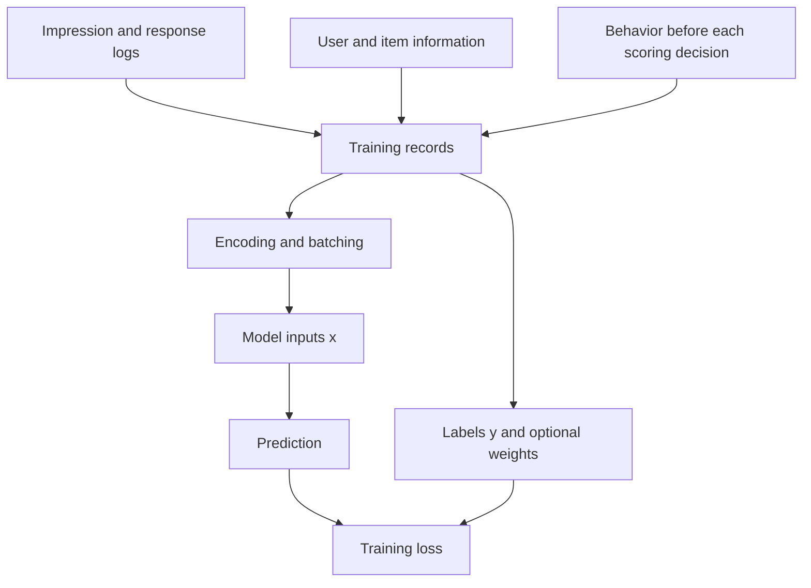

# A beginner guide to training data for ads and recommendations

# What one training example means

An ads or recommendation model learns from past interactions so that it can score a future opportunity: **given this user, this candidate item, and this situation, how likely is a particular outcome?** This guide starts with click prediction, then explains retrieval, ratings, conversions, and sequence prediction. You need no prior knowledge of recommendation systems. A **neural network** is a model with adjustable numbers called **parameters**; training changes those numbers to reduce an error score called the **loss**. Technical terms are explained as they appear and collected in the glossary.

An **item** is the thing being recommended: an ad, product, video, article, or song. A **candidate** is an item being considered. An **impression** is a logged showing of an item under your system's exposure definition. A **click** is one possible response to that impression. **Serving** means running a trained model on live requests.

For a click prediction model, one training example usually describes **one item shown to one user at one time**, plus whether that showing led to at least one valid click within a defined window. **CTR**, or **click-through rate**, is clicked impressions divided by impressions under that binary-label rule. **pCTR** is the model's predicted probability of a click.

| User | Candidate shown | Situation at display time | Outcome |
| --- | --- | --- | --- |
| U7 | Running shoe ad A42 | Mobile home feed at 10 AM UTC | Clicked |
| U7 | Camera ad A81 | Mobile home feed at 10 AM UTC | Did not click |
| U9 | Running shoe ad A42 | Desktop at 8 PM UTC | Did not click |

These rows are invented teaching examples. The same user and the same ad can occur many times; each showing is a distinct event.

The information used to make a prediction is called the **features**, often written as `x`. The answer used to teach the model is the **label**, often written as `y`. For click prediction, `y=1` means clicked and `y=0` means not clicked under the chosen rule.

```text
x = user information + candidate information + context + earlier behavior
y = observed outcome after this opportunity

model(x) = estimated probability of a click
```

An output of 0.03 is intended as a 3% click probability. A **calibrated** model is one whose probabilities agree with observed frequencies: across many comparable opportunities scored near 0.03, roughly 3% should receive a click. Calibration must be checked on the population where the model is used; sampled training data can distort it. An individual prediction is not a guarantee.

There are three distinct representations to keep straight:

| Representation | What it contains |
| --- | --- |
| Raw logs | Events such as impressions, clicks, purchases, and page views |
| Training records | Joined features, labels, and bookkeeping for each example |
| Model tensors | Numerical arrays with specified shapes and types that the model computes on |

A CSV file, a JSON record, and a Parquet table can all represent the same logical examples. The file extension does not determine what the model learns, provided the loader preserves types and values. For example, a CSV reader must not discard leading zeros in IDs or silently conflate missing values with empty strings. CSV is a text table format; JSON represents named fields and lists; Parquet stores typed table columns efficiently.



# From raw events to training rows

## The information usually lives in several tables

A web application does not normally log a complete neural-network input whenever someone clicks. It records different events and maintains separate information about users and items. A training pipeline combines them.

The following tables are an invented miniature shopping app.

**Impressions**

```text
impression_id  request_id  user_id  item_id  shown_at              surface
imp_101        req_10      U7       A42      2026-11-01T10:00:00Z  home_feed
imp_102        req_10      U7       A81      2026-11-01T10:00:00Z  home_feed
```

**Requests**

```text
request_id  scored_at             device  surface
req_10      2026-11-01T09:59:58Z  mobile  home_feed
```

**Clicks**

```text
impression_id  clicked_at
imp_101        2026-11-01T10:00:05Z
```

**Item information available at the time**

```text
item_id  category  price   valid_from            valid_to
A42      shoes     80.00   2026-10-20T00:00:00Z  2026-11-01T12:00:00Z
A42      shoes     65.00   2026-11-01T12:00:00Z  (open)
A81      cameras   300.00  2026-10-20T00:00:00Z  (open)
```

**Earlier user behavior**

```text
user_id  item_id  category  action  occurred_at           available_at
U7       A12      shoes     view    2026-11-01T09:40:00Z  2026-11-01T09:40:02Z
U7       A18      shoes     view    2026-11-01T09:50:00Z  2026-11-01T09:50:02Z
U7       A33      books     view    2026-11-01T09:55:00Z  2026-11-01T09:55:02Z
```

## How one row is assembled

A **request** asks the system to choose recommendations. The model scores req_10 at 09:59:58; the two impressions are logged as shown at 10:00:00. For imp_101, attach the information about U7 and A42, the device and surface from the request, and behavior available before 09:59:58. The training record stores the request's scored_at as prediction_time. All timestamps here use UTC, a common worldwide time reference; the Z suffix marks UTC. After the click observation window closes, attach the label.

For this example, assume a 30-minute click window starting at shown_at, with the start included and end excluded. Allow another five minutes for click logs to arrive; both labels are final at 10:35. A **positive** example has label 1; a **negative** example has label 0. The valid click at 10:00:05 makes imp_101 positive. With no valid attributed click in its window, imp_102 is negative after finalization. These durations are teaching assumptions, not universal rules. Multiple valid clicks on one impression still produce one binary label.

**Attribution** is the rule assigning an outcome to an impression or click. Here a shared impression identifier makes it simple; the chapter on recommendation tasks explains how ad platforms attribute conversions that happen later on another website or app. **Deduplication** removes repeated copies of the same event; it must not erase distinct showings.

Join response events using an impression identifier or an explicitly defined attribution rule. Joining on user ID and item ID alone can attach one click to several different showings.

## The time boundary is part of the format

For the 10:00 impression scored at 09:59:58:

- Features must represent information the scoring system could have used at its decision time.

- Historical behavior must stop before that decision.

- The response label can use later events inside its specified window.

- A count such as “clicks in the last seven days” must be computed as of that decision, not as of the day you build the dataset.

Including the 10:00:05 click in the history used to predict that same click is **data leakage**: the answer has slipped into the question.

Time matters for item and user metadata too. If an item's price changed at noon, the 10:00 training row should not silently use the noon price. Delayed event arrival also matters: a behavior that occurred at 09:59:00 but reached your system at 10:02 was unavailable when the 10:00 impression was scored at 09:59:58.

Matching records across tables is a **join**. A **point-in-time join** selects information valid and available at the scoring cutoff. In this example, require both occurred_at < scored_at and available_at < scored_at for history. Pick the item version whose interval includes scored_at: valid_from is inclusive and valid_to exclusive. The metadata table assumes each version was available from valid_from; if corrections arrive later, also record when each version became available.

Fields used for joining and auditing do not automatically become model features. Keep `impression_id` to identify the event; do not blindly feed a unique event identifier into the neural network.

# Turning feature values into model inputs

## Categorical features identify things

User IDs, item IDs, categories, and device types are usually categorical. Their numerical spelling does not imply numerical distance: item 100 is not “twice” item 50.

A vocabulary maps each category to an integer index. An **embedding table** then maps each index to a small vector of learned numbers. Here is an invented mapping:

```text
category vocabulary
PAD     -> 0
UNKNOWN -> 1
shoes   -> 2
books   -> 3
cameras -> 4

Illustrative learned embedding for shoes:
2 -> [0.12, -0.40, 0.08, 0.31]
```

The vector is a model parameter, learned during training. You do not manually write “0.12” into every raw shoes record. Raw records store the category; encoding produces an index; the model looks up its vector.

Each feature normally has its own vocabulary and embedding table. User index 2 and category index 2 are unrelated. A candidate item and a history item often share both a vocabulary and an embedding table. Shared indices alone do not ensure shared vectors: separate embedding tables can learn different vectors for the same index.

Reserve a way to represent unseen values, often called **unknown** or **out of vocabulary**. A new item can have an unknown item ID while still supplying useful category, price, and content features.

For very large vocabularies, **feature hashing** maps values into a fixed number of buckets. It saves vocabulary management but permits collisions: different values may share a bucket.

## Numerical features measure quantities

Price, recent impression count, elapsed time, and video duration are numerical. They generally become floating-point values.

Possible transformations include dividing by a scale, standardizing using a training-set mean and standard deviation, or applying `log(1+x)` to a nonnegative count. Choose transformations for the feature's meaning; there is no mandatory universal normalization.

Missing and zero are different facts. “Price unavailable” is not the same as “free.” You can use a default value plus a separate missing-value indicator.

## History features contain lists

A user's recent interactions form a variable-length list. A model batch (a group of examples processed together) often pads lists to a maximum length and supplies a length or mask identifying the real entries:

```text
Actual history:        [A12, A18, A33]
Encoded and padded:   [ 12,  18,  33, 0, 0]
Valid-entry mask:     [  1,   1,   1, 0, 0]
Length:               3
```

Here the latest L=5 events are kept, ordered oldest first, and padded on the right. L is the maximum retained history length. Zero is reserved for padding; it cannot identify a normal item. The mask marks valid entries: 1/0 and True/False are two common representations.

If you include item IDs, categories, actions, and timestamps for each event, keep their positions aligned. The second category must describe the second item. For a first implementation, retain the latest L events in a documented order.

**Providing an ordered list does not by itself make a model order-sensitive.** A simple sum or average discards ordering. The **Deep Interest Network (DIN)** model, introduced later, weights historical behaviors by relevance to the candidate. Its weighted sum also discards order unless order-related features are added. Other sequence models can use positions or timestamps; a recurrent model updates a running summary as it processes each event.

## Text and images are optional inputs

An item's title can become text tokens or a vector from a text encoder. An image can become pixels or a vector from an image encoder. These complement IDs, especially for unfamiliar items. They are not required to understand or train a basic CTR model.

TensorFlow's [feature preprocessing tutorial](https://www.tensorflow.org/recommenders/examples/featurization) provides concrete examples of processing IDs, numerical values, and text. Keep the same preprocessing definitions for training and live predictions; an index must mean the same thing in both places.

# A complete worked example

## A human readable training record

The following JSON is an invented teaching schema for `imp_101`. It makes the feature boundary explicit.

```json
{
  "metadata": {
    "impression_id": "imp_101",
    "request_id": "req_10",
    "prediction_time": "2026-11-01T09:59:58Z",
    "shown_at": "2026-11-01T10:00:00Z",
    "label_finalized_at": "2026-11-01T10:35:00Z"
  },
  "features": {
    "user_id": "U7",
    "candidate_item_id": "A42",
    "candidate_category": "shoes",
    "candidate_price": 80.0,
    "device": "mobile",
    "surface": "home_feed",
    "hour_utc": 9,
    "recent_history": [
      {"item_id": "A12", "category": "shoes"},
      {"item_id": "A18", "category": "shoes"},
      {"item_id": "A33", "category": "books"}
    ]
  },
  "labels": {
    "clicked": 1
  },
  "sample_weight": 1.0
}
```

`metadata` helps reconstruct and audit an example. `features` is the allowed prediction input. `labels` provides the target only during training and evaluation. A `sample_weight` tells the loss how much that example counts; 1.0 means ordinary equal weighting.

Here, price means the product's price, not the advertiser's bid. The choice of fields is illustrative; it does not claim that every production ranker takes these inputs.

## The corresponding numerical input

Use these invented vocabularies. In every vocabulary here, 0 is reserved for padding and 1 for unknown; real values use indices 2 or greater. The digit-like ID mappings below are explicitly chosen entries, not a general rule for converting IDs. No real item gets index 0 or 1. Non-history features do not need padding in practice; this example reserves the same slots for clarity.

| Feature | Mapping |
| --- | --- |
| user_id | U7 → 7 |
| candidate_item_id and history_item_ids | A12 → 12, A18 → 18, A33 → 33, A42 → 42 |
| device | mobile → 2 |
| surface | home_feed → 2 |
| category | shoes → 2, books → 3 |

Divide price by 100 and hour_utc by 23. The hour comes from the scoring time, which is still 09:59:58, so its value is 9. The simple hour scaling is for teaching; local hour, categorical hours, or cyclic representations can better capture daily patterns. **Dense** below means the measured numerical features. **Sparse** conventionally describes categorical features whose full **one-hot** representation would be mostly zeros. A one-hot vector has one position per vocabulary entry: 1 for the observed value and 0 everywhere else. With a million items, that is 999,999 zeros, so the model usually receives the compact index instead.

```python
# Batch size B = 1; maximum history length L = 5.
x = {
    "user_id": [7],
    "candidate_item_id": [42],
    "candidate_category": [2],
    "device": [2],
    "surface": [2],
    "dense": [[0.80, 9 / 23]],
    "history_item_ids": [[12, 18, 33, 0, 0]],
    "history_category_ids": [[2, 2, 3, 0, 0]],
    "history_mask": [[True, True, True, False, False]]
}

y = [[1.0]]
weight = [[1.0]]
```

This Python dictionary describes tensor contents. A tensor is a numerical array with a shape and data type. A loader turns these lists into the arrays a framework expects.

| Input | Shape for batch size B | Typical type |
| --- | --- | --- |
| One categorical feature | B or B × 1 | Integer indices |
| Two numerical features | B × 2 | Float32 |
| Item history | B × 5 | Integer indices |
| History mask | B × 5 | Boolean |
| Click label | B × 1 | Float32 for binary loss |

For B=32, you stack 32 examples along the first dimension. That group is a **batch**. An **epoch** is one pass through the training dataset.

## What the model does with it

A possible model looks up embeddings for the categorical values, summarizes the valid history entries, **concatenates** (joins end to end) the resulting vectors with the numerical features, and passes the result through a neural network. Its final output is a click probability.

For a binary label y and predicted probability p, **binary cross-entropy** is −[y × ln(p) + (1−y) × ln(1−p)]. Here ln is the natural logarithm; the formula makes a confident wrong prediction expensive. For p=0.20 and y=1, loss is −ln(0.20) ≈ 1.609. For y=0 it is −ln(0.80) ≈ 0.223. **Log loss** is this loss averaged over examples. Training adjusts parameters, including embeddings, to reduce it. The formula is conceptual; libraries use numerically stable implementations.

```python
# Framework-neutral training outline, not runnable API code.
prediction = model(x)
loss_per_example = binary_cross_entropy(prediction, y)
loss = mean(weight * loss_per_example)
update_model_parameters(loss)
```

The pseudocode uses the mean of weighted losses. Some libraries divide by the sum of weights instead; this changes the scaling within a batch and can change the relative contribution of batches with different weight totals. Match your framework's reduction convention.

At prediction time, you have `x` but do not yet know `y`. To rank ten candidates, construct ten candidate-specific inputs. Some user and context computation can be shared across them.

# Published Criteo and DIN examples

## Criteo provides real anonymized rows

The [DeepCTR-Torch Criteo tutorial](https://deepctr-torch.readthedocs.io/en/latest/Examples.html#classification-criteo) uses 13 numerical fields and 26 categorical fields. In its [published sample file](https://github.com/shenweichen/DeepCTR-Torch/blob/master/examples/criteo_sample.txt), the first example has label 0. These are selected fields from that exact row, not an invented record:

```python
{
    "label": 0,
    "I1": None,
    "I2": 3,
    "I3": 260.0,
    "I5": 17668.0,
    "I8": 33.0,
    "C1": "05db9164",
    "C2": "08d6d899",
    "C3": "9143c832"
}
```

The original row has 39 feature columns, some empty; this excerpt omits the rest. The published feature names are anonymized. You cannot infer that C1 means user or that I3 means age.

The [example training script](https://github.com/shenweichen/DeepCTR-Torch/blob/master/examples/run_classification_criteo.py) replaces missing values, label-encodes categorical fields independently, and scales numerical columns. For the full 200-row sample, the first row's C1, C2, and C3 encode to 0, 4, and 96, respectively. These are vocabulary indices, not intrinsic meanings of the original strings.

The demo reserves no unknown index: zero can be a real category here, unlike our worked example. An unseen serving category needs an explicit handling rule. Filling missing numbers with zero also loses the distinction between missing and genuine zero unless an indicator is added. Public benchmark click rates can differ from live traffic; do not assume their probabilities transfer unchanged.

This example is good for understanding the mechanical path from table columns to embeddings. It is less useful for understanding the business meaning of each feature. [NVIDIA's Criteo overview](https://developer.nvidia.com/blog/optimizing-dlrm-on-nvidia-gpus/) explains the anonymized numerical and hashed categorical format.

## DIN makes candidate and history inputs explicit

Alibaba's [DIN paper, Section 4.1](https://arxiv.org/html/1706.06978v4#S4.SS1), uses the feature example below, reformatted from a set of visited categories into a list:

```python
{
    "weekday": "Friday",
    "gender": "Female",
    "visited_cate_ids": ["Bag", "Book"],
    "ad_cate_id": "Book"
}
```

The paper's idea is to build a user-interest representation that depends on which ad is being scored. A book candidate can emphasize book-related history.

For numerical input, the first toy example in DeepCTR-Torch's [DIN demo](https://github.com/shenweichen/DeepCTR-Torch/blob/master/examples/run_din.py#L11-L30) is:

```python
x = {
    "user": [0],
    "gender": [0],
    "item": [1],
    "item_gender": [1],
    "score": [0.1],
    "hist_item": [[1, 2, 3, 0]],
    "hist_item_gender": [[1, 1, 2, 0]],
    "seq_length": [3]
}
y = [1]
```

This is synthetic demonstration data from a third-party library, not an Alibaba production record. The history has three valid entries and one padding position. In this separate demo, zero is a real user or gender value but pads the item history; reserved indices are feature-specific and differ from our uniform teaching convention. The demo does not specify a business meaning for score. Candidate item 1 also occurs in its history: in real data that is valid only for a genuinely earlier interaction. The demo uses label shape B, while the worked example uses B × 1; match your library's required label shape and type.

Criteo and DIN illustrate different input structures. They are not two serializations of the same dataset.

# How data changes across recommendation tasks

“Recommendation training data” does not identify a single universal schema. First decide the question the model answers.

| Task | One example represents | Target |
| --- | --- | --- |
| CTR ranking | One logged showing of a candidate | Click within a defined window |
| Rating prediction | A user rating an item | A numerical rating |
| Retrieval | A user or query context paired with a relevant item | Relevant item versus contrasting items |
| Conversion prediction | An eligible impression or click | Attributed conversion within a window |
| Next-item prediction | A history ending at a cutoff | The next observed item |
| Pairwise ranking | Two items under a shared context | Which item is preferred |
| Listwise ranking | A group of candidates under a shared request | Per-item relevance or outcome labels |

## Ranking can train on individual rows

A model trained to predict clicks independently can still rank items by its predictions. It does not need to receive a sorted list during every training step. This is commonly called **pointwise** training.

For explicit ratings, a row might be `user=U7, item=A42, rating=4`. The rating is a numerical target, not a click label. TensorFlow's [ranking tutorial](https://www.tensorflow.org/recommenders/examples/basic_ranking) demonstrates retaining the user, movie title, and rating, then predicting the rating.

## Retrieval needs contrasting candidates

Retrieval finds a manageable candidate set from a large catalog. A common two-tower design separately turns user/context features and item features into vectors, then scores their compatibility.

An invented training example could be:

```python
{
    "user_id": "U7",
    "history": ["A12", "A18"],
    "positive_item": "A42",
    "sampled_other_items": ["A81", "A90"]
}
```

Here a positive item is an observed relevant interaction, and a negative is a sampled contrast, not a proven dislike. Some training methods use other examples' positive items as **in-batch negatives**. You need not store every contrasting pair explicitly in the file. TensorFlow's [retrieval tutorial](https://www.tensorflow.org/recommenders/examples/basic_retrieval) demonstrates a two-tower setup with user-item interactions.

Popular items appear more often as other examples' positives, so the distribution of in-batch contrasts can be skewed. Some training methods adjust for their sampling probabilities.

A retrieval similarity score is not automatically a calibrated probability of a click. Also, an unobserved item may be relevant even when training uses it as a contrast.

## Next-item prediction uses a shifted history

In an invented chronological history `[A12, A18, A33, A42]`, one training example can be:

```python
x = {"history": ["A12", "A18", "A33"]}
y = "A42"
```

The target must not appear in the input as a future event; earlier interactions with that same item are legitimate. In **causal sequence training**, each prediction sees only earlier positions; several positions can therefore supply targets. The target is an item identifier rather than a binary click.

## Pairwise and listwise data preserve comparisons

Pairwise data might contain `context, preferred_item, other_item`. Listwise data might contain `request_id, candidate_items, labels, valid_item_mask`. Keep the request grouping so the loss knows which items are being compared. Padding a candidate list requires masking its padded entries.

## Ads share input types but add business objectives

Ads can use the same user, item, context, and history inputs as product recommendations. They additionally involve payment rules, targeting, budgets, and advertiser objectives.

A **conversion** is a downstream action such as a purchase or signup. **CPC** means **cost per click**, a payment arrangement where a valid click is the billable event. A **bid** is the advertiser's offer per billable event. In a simplified CPC setup, a downstream scoring rule may multiply predicted click probability by a bid per click. The bid need not be a CTR model feature. Similarly, product price and advertiser bid are distinct quantities.

For conversion models, state the denominator. **CVR** means conversion rate; **pCVR** is a predicted conversion probability. **Conditional probability** means the chance of one event given specified information. A post-click model estimates P(conversion given click and impression features). An impression-level model estimates P(conversion given impression features).

For a common impression context x, the probability identity is:

```text
P(click AND conversion | x)
  = P(click | x) × P(conversion | click, x)
```

The vertical bar means “given.” Thus pCTR × post-click pCVR estimates the joint click-and-conversion probability. It represents the probability of an attributed conversion per impression only if the conversion definition requires that matching click. It excludes view-through conversions, which are credited without a click. Click windows, invalid-click filtering, conversion windows, and attribution must agree. Any inputs needed at scoring must be available then; later post-click information cannot be silently used. A post-click CVR model trains on clicked rows but is applied to candidates whose click is not yet known. Extrapolating from this selected population is a form of sample selection bias. The joint prediction is sometimes written pCTCVR, meaning a predicted click-and-conversion probability.

Multiplying pCTR by an already impression-level conversion probability counts the click factor twice. When a probability is multiplied by bids or values, its calibration matters to the resulting economic score.

A multi-task record can carry click, conversion, and watch-time labels. Some targets are undefined for some rows; use explicit validity masks rather than silently treating every missing target as zero.

## How attribution is done in practice

In the worked example, attribution was trivial: the click record carried the same `impression_id` as the impression. Conversions are harder. A purchase usually happens later, often on the advertiser's own website or app, and the person may have seen or clicked several ads first. Ad platforms solve this in three steps, and each step changes what your conversion label means:

1. **Link** the conversion to earlier ad interactions.
2. **Filter** those interactions by time windows.
3. **Assign credit** when more than one interaction qualifies.

### Step 1: Linking a conversion to ad interactions

The conversion and the ad interaction are logged by different systems, so something must connect them. The common mechanisms are:

| Mechanism | What connects the two events | Documented example |
| --- | --- | --- |
| Click identifier | The ad platform adds a unique ID to the landing-page URL on each click. The advertiser stores it with the lead or order and sends it back with the conversion. | Google's GCLID, used in [offline conversion imports](https://support.google.com/google-ads/answer/7012522) |
| Server event with customer information | The advertiser's server sends the conversion with hashed customer details and any stored click ID. The platform matches them to its own users. | Meta's [Conversions API](https://developers.facebook.com/docs/marketing-api/conversions-api/) |
| On-device attribution | The phone's operating system records ad impressions, decides the winner itself, and later sends the ad network a delayed report without a user identifier. | Apple's [AdAttributionKit](https://developer.apple.com/documentation/adattributionkit/receiving-ad-attributions-and-postbacks) |

Concretely:

- **Google click identifier.** With auto-tagging, Google adds a GCLID to each ad click's URL. The advertiser's page saves it, for example in a cookie, and attaches it to the lead record. When the lead later becomes a sale, the advertiser uploads the GCLID, the conversion name, and the conversion time. Depending on the import source, the click must be less than 14 or 90 days before the conversion.
- **Meta Conversions API.** Contact fields such as email and phone must be SHA-256 hashed before sending. The click ID travels in the `fbc` value, which embeds the `fbclid` URL parameter. The same purchase often arrives twice, once from the browser pixel and once from the server. Meta deduplicates the pair when both carry the same `event_id` and event name and arrive within 48 hours of the first.
- **Apple AdAttributionKit.** The device keeps qualifying impressions and picks one winning ad network after an install. Up to five other ad networks can receive a non-winning report. The winning network learns about the conversion through a postback, a signed report sent at least 24 to 48 hours after the event. Apple states that the postback contains no user- or device-specific data. It carries conversion values set by the advertised app, with less detail when too few people share the same values, a rule Apple calls crowd anonymity.

Chrome's Privacy Sandbox offered a browser-based equivalent, the Attribution Reporting API. Google [announced its retirement](https://privacysandbox.google.com/blog/update-on-plans-for-privacy-sandbox-technologies) on October 17, 2025.

Linking is never complete. A conversion without a stored click ID or matchable customer details cannot be attributed. In training data, such a row looks like "no attributed conversion" even though a sale happened.

### Step 2: Windows decide which interactions qualify

A **lookback window**, also called a conversion window, is the period after an ad interaction during which a conversion can be credited to it. Windows are platform settings, not facts about users:

| Platform | Click-through | View-through | Other |
| --- | --- | --- | --- |
| [Google Ads](https://support.google.com/google-ads/answer/3123169) | Default 30 days; 1 to 90 days depending on conversion source | Default 1 day; up to 30 days | Engaged-view for video: default 3 days |
| [Meta](https://www.facebook.com/business/help/2198119873776795) | 1 or 7 days after a link click | 1 day after an impression | Engage-through: 1 day after a non-link click or a 5-second video play |
| [Apple AdAttributionKit](https://developer.apple.com/documentation/adattributionkit/receiving-ad-attributions-and-postbacks) | 30 days from ad tap to install | 24 hours from ad view to install | First conversion value update within 60 days of install |

Google states that a conversion after its window is not recorded, and a window change applies only to future conversions. If your label claims to match platform-reported conversions, it must use the same anchor, length, and interaction type.

### Step 3: Credit rules when several interactions qualify

Suppose, in an invented journey, U7 clicks shoe ad A42 on November 1, sees a display ad for the same store on November 3 without clicking, clicks a search ad for the store on November 4, and buys on November 5. Both clicks fall inside a 30-day click-through window. The view happened two days before the purchase, so a 1-day view-through window excludes it. Different rules then divide the one conversion like this:

| Rule | A42 click (Nov 1) | Display view (Nov 3) | Search click (Nov 4) |
| --- | --- | --- | --- |
| Last click | 0 | 0 (outside window) | 1 |
| First click | 1 | 0 (outside window) | 0 |
| Linear | 0.5 | 0 (outside window) | 0.5 |
| Data-driven | Learned share | 0 (outside window) | Learned share |

With a 3-day view-through window instead, the view would qualify, and linear credit would become one third each. The window and the credit rule interact.

- **Last click** gives all credit to the last-clicked ad. Criteo's attribution paper calls last click within 30 days the industry standard; see [Diemert et al., 2017](https://arxiv.org/abs/1707.06409).
- **Rules-based multi-touch models** (first click, linear, time decay, and position-based) split credit by fixed formulas. Google's [attribution models page](https://support.google.com/google-ads/answer/6259715) says these four are no longer supported; conversion actions using them were upgraded to data-driven.
- **Data-driven attribution** learns credit from data and is Google's default for most conversion actions. Google's [description](https://support.google.com/google-ads/answer/6394265) says it compares the paths of customers who convert to the paths of customers who do not, and recommends at least 200 conversions and 2,000 ad interactions in 30 days. A published academic basis for this family is the Shapley value from cooperative game theory, applied to advertising channels by [Dalessandro et al., 2012](https://doi.org/10.1145/2351356.2351363), building on Shao and Li's 2011 KDD paper on data-driven multi-touch attribution.
- **Incremental attribution** asks a different question: would this conversion have happened without the ad? Meta's standard attribution credits conversions within the chosen windows, while its incremental option optimizes for conversions that models predict were caused by the ad.

Counting is a separate setting. Google's [counting options](https://support.google.com/google-ads/answer/3438531) count either every conversion after an ad interaction or only one conversion per click.

Each platform attributes using only the interactions it can see and its own rules. Two platforms can therefore both claim the same purchase, and their totals need not add up to the advertiser's actual orders.

### What this means for your training labels

Criteo's public [Attribution Modeling for Bidding dataset](https://ailab.criteo.com/criteo-attribution-modeling-bidding-dataset/) shows the distinction in real data. Each of its 16.5 million rows is one impression with two separate targets. `conversion` is 1 if any conversion occurred in the 30 days after the impression, whether or not this impression was the last click. `attribution` is 1 only if the advertiser attributed that conversion to Criteo. Fields such as `click_pos`, `click_nb`, and `time_since_last_click` describe the click path.

When you build conversion labels:

- **Choose the target explicitly.** "Any conversion within N days of this impression" and "conversion credited to this impression under rule R" are different labels with different rates.
- **Version the attribution definition.** Record the linking method, windows, credit rule, and counting setting in the data dictionary. Platform defaults change over time, and mixing data from different rules changes what label 1 means.
- **Expect late and missing labels.** Conversions can take place long after the impression; [Chapelle, 2014](https://doi.org/10.1145/2623330.2623634) reports delays of up to a month in display advertising. Offline imports and on-device postbacks add reporting delay on top. Set label finalization after both the window and the reporting delay.
- **Treat fractional credit as a modeling decision.** A data-driven share such as 0.4 is not an observed 0/1 outcome. If you train on it, document whether it is a regression target, a sample weight, or thresholded into a binary label.
- **Do not let attribution leak into features.** A field such as `click_pos` or the final credited touchpoint is computed after the conversion. Keep it for labeling and analysis, not as a prediction input.

# Labels sampling and evaluation

## A negative label needs an observation rule

A displayed item with no recorded click is evidence about that showing. It is not proof that the user dislikes the item. A candidate that was never displayed has no observed response to that opportunity.

For click training, keep impression logs as well as click logs. Click-only data cannot directly tell you the rate of clicks per impression.

Conversions may take hours or days. For an invented click-attributed conversion target measured over seven days from the impression, a record collected one hour after that impression cannot yet be confidently labeled “no conversion.” Wait for the window, mask immature labels, or use a method explicitly designed for delayed outcomes. Record the attribution definition, the window anchor, and when labels become final after allowing for delayed logs. A positive can be observed earlier, but retaining early positives alongside immature negatives can itself bias a training sample.

## Sampling changes what the model sees

Suppose an invented dataset has 1,000 clicks and 99,000 non-clicks: the click rate is 1%. If you keep all clicks and only 1,000 non-clicks, the sampled rate becomes 50%.

A model trained without an appropriate adjustment may learn probabilities for the sampled population. A prediction of 50% would not mean a 50% click chance in live traffic.

If a row is retained with probability q, inverse-probability weighting uses weight `1/q`. For this illustration, the retained negatives have weight 99 and positives weight 1. Other correction methods exist; whichever you choose must match the sampling procedure. Google's [imbalanced dataset lesson](https://developers.google.com/machine-learning/crash-course/overfitting/imbalanced-datasets) discusses downsampling and compensating weights.

For honest probability evaluation, use an unsampled representative test set or appropriate evaluation weights. If negative sampling is independent of features within each class, AUC (a ranking metric measuring how often a random positive scores above a random negative, expanded in the metrics table below) is unchanged in expectation for fixed scores, but raw log loss and calibration on the sampled data are not population estimates.

Candidate sampling for retrieval serves a different purpose from discarding non-clicked impressions in CTR training. Keep those two choices distinct.

## Evaluate predictions on later data

A useful initial split is older events for training, a later interval for validation, and a still later interval for a final test. These intervals are not themselves model features. They determine which examples are used for learning, choosing settings, and assessing the chosen model.

For conversion labels, make sure the training outcomes would have matured by the simulated model-build time, or explicitly account for their availability. A chronological split alone does not solve delayed-label leakage.

Fit vocabularies, scaling statistics, and other learned preprocessing on the training portion, then apply them consistently to validation, test, and serving inputs. Reserve unknown categories. The Criteo demo fits transformations before a random split; that is convenient demo code, not the evaluation procedure to copy for a temporal production problem.

The same user can legitimately appear in training and later test data if predicting returning users is your use case. To measure performance on new users or new items, construct that evaluation separately.

## Match metrics to the target

| Metric | What it helps you inspect |
| --- | --- |
| Log loss | Whether predicted probabilities agree with outcomes |
| AUC | Area under the receiver operating characteristic curve; measures how often a positive scores above a negative, counting ties as half |
| Calibration | Whether groups predicted near 3% actually click near 3% |
| Recall at K | Of all relevant items, the fraction appearing in the first K results; K is the list length |
| NDCG at K | Normalized discounted cumulative gain; rewards relevance near the top, relative to an ideal ordering |

For rare clicks, accuracy can be misleading: predicting “no click” for everything can appear very accurate.

Offline evaluation still reflects the old system's exposure choices. Items it rarely showed have little outcome data. Position, selection, and feedback loops can therefore bias results. An **online experiment**, often an A/B test, assigns live traffic to alternative systems to compare outcomes. Such experiments help measure a changed system's effect on users and the marketplace. Google's [View from the Trenches](https://research.google/pubs/ad-click-prediction-a-view-from-the-trenches/) is a useful follow-up on calibration and practical CTR evaluation.

# A practical starting schema

For a first CTR dataset, use one row per impression. Start with user, item, context, and a click label; add behavior lists when the simple path is understood.

| Field | Role | Meaning |
| --- | --- | --- |
| impression_id | Metadata | Unique showing identifier for joins and deduplication |
| request_id | Metadata | Groups items from one recommendation request |
| prediction_time | Metadata | Scoring decision time; defines the feature cutoff |
| shown_at | Metadata | Logged exposure time; anchors this guide's label windows |
| user_id | Feature | User identity, with an unknown value supported |
| candidate_item_id | Feature | Candidate identity, with an unknown value supported |
| candidate_category | Feature | Candidate category |
| device | Feature | Device class known when scoring |
| surface | Feature | Page or placement being scored |
| hour_utc | Feature | UTC hour derived from prediction_time |
| candidate_price | Optional feature | Product price as known at prediction time |
| recent_history | Optional feature | Aligned item and category records before the cutoff |
| history_length | Input helper | Number of valid history entries |
| clicked | Label | Attributed click within the defined window |
| label_finalized_at | Metadata | Time after which the click target is complete |
| sample_probability | Metadata | Probability that this example was retained |
| sample_weight | Loss input | Weight appropriate to the training procedure |

Apply your organization's consent, access, and retention rules to user-level logs.

You can store this in Parquet, including list-valued history columns. CSV is convenient for the flat version; JSON is easier to inspect manually. A training loader reads records and produces the same logical numerical arrays regardless of storage format.

The loader turns recent_history into history_item_ids and history_category_ids, generates a mask, derives hour_utc from prediction_time, and puts transformed candidate_price and hour_utc into dense. It maps each categorical field (user, item, category, device, and surface) to indices. The JSON and the tensor dictionary therefore use different names only for explicit transformations.

Keep a small **data dictionary** beside the dataset. For each field, specify its meaning, type, allowed values, units, missing-value behavior, and whether it is an input or label. Also preserve the vocabulary, transformations, history order, maximum history length, target window, and schema version with the model.

Before training, inspect a few complete examples manually:

1. Can you trace each label to a real impression and its attributed response?

2. Do all features obey the decision-time cutoff?

3. Are duplicated events removed without collapsing legitimate repeated impressions?

4. Do padding, unknown, and missing values have distinct documented meanings?

5. Are parallel history arrays aligned and lengths correct?

6. Are training and live prediction encodings identical?

7. Does the train/test split match the future behavior you want to evaluate?

Do not automatically feed every logged field into the model. For example, the actual final position after ranking may be unavailable when scoring candidates. Keep it for analysis; if a model uses position, define how it will know the proposed position during serving.

A successful first milestone is being able to select one raw impression and explain every number in its model input, every historical event included, and exactly why its label is 0 or 1.

# Sources and next steps

The published samples and the invented worked example serve different purposes. Use the original files when reproducing their exact preprocessing; use the worked example to understand the meaning of the fields.

| Read | Focus |
| --- | --- |
| [DeepCTR-Torch Criteo tutorial](https://deepctr-torch.readthedocs.io/en/latest/Examples.html#classification-criteo) | Tabular CTR features and preprocessing |
| [Criteo sample file](https://github.com/shenweichen/DeepCTR-Torch/blob/master/examples/criteo_sample.txt) | Actual anonymized feature values |
| [Criteo training script](https://github.com/shenweichen/DeepCTR-Torch/blob/master/examples/run_classification_criteo.py) | How columns become training inputs |
| [DIN paper Sections 4.1 to 4.3](https://arxiv.org/html/1706.06978v4#S4) | Feature representation and candidate-dependent history weighting |
| [DIN toy input code](https://github.com/shenweichen/DeepCTR-Torch/blob/master/examples/run_din.py) | Concrete categorical and history arrays |
| [TensorFlow feature preprocessing](https://www.tensorflow.org/recommenders/examples/featurization) | IDs, numerical values, and text |
| [TensorFlow retrieval tutorial](https://www.tensorflow.org/recommenders/examples/basic_retrieval) | User and candidate towers |
| [TensorFlow ranking tutorial](https://www.tensorflow.org/recommenders/examples/basic_ranking) | Explicit rating targets |
| [Google on imbalanced datasets](https://developers.google.com/machine-learning/crash-course/overfitting/imbalanced-datasets) | Sampling and weights |
| [Google View from the Trenches](https://research.google/pubs/ad-click-prediction-a-view-from-the-trenches/) | Practical probability prediction and calibration |
| [Google Ads conversion windows](https://support.google.com/google-ads/answer/3123169) and [attribution models](https://support.google.com/google-ads/answer/6259715) | Lookback windows, last click, and data-driven credit |
| [Meta attribution settings](https://www.facebook.com/business/help/2198119873776795) | Click-through, view-through, engage-through, and incremental attribution |
| [Apple AdAttributionKit](https://developer.apple.com/documentation/adattributionkit) | On-device app-install attribution and postbacks |
| [Criteo attribution dataset](https://ailab.criteo.com/criteo-attribution-modeling-bidding-dataset/) | Real rows with separate conversion and attribution labels |
| [Chapelle, Modeling delayed feedback](https://doi.org/10.1145/2623330.2623634) | Conversion labels that arrive late |

For your first exercise, inspect a few rows of the Criteo sample and follow the numerical and categorical transformations in its script. Then inspect the DIN demo and identify the candidate, valid history entries, padding, and label. After that, build the invented impression example above in a small dataset of your own.

You understand the format when you can answer: What opportunity does this row describe? What was known at prediction time? What is being predicted? How did each field become a tensor? Which outcome supplied the label?
